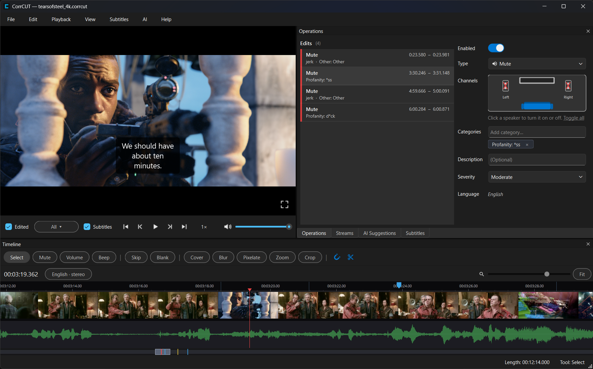

# CorrCUT



*Editor screenshot. Picture: [Tears of Steel](https://mango.blender.org/) — (CC) Blender Foundation | mango.blender.org, [CC BY 3.0](https://creativecommons.org/licenses/by/3.0/). Not a Blender Foundation endorsement.*

Windows app for private home viewing. It saves a project file (`{stem}.corrcut`) beside the movie and can export a CorrMedia sidecar (`{stem}.corr.json`). Preview, a waveform timeline, captions, OCR, and Whisper are in the editor. CorrMedia applies the sidecar while that file plays. The app does not create a new movie file.

## Use

For private home viewing of a copy you are allowed to play. Work is saved in a .corrcut project. Export writes a corr.json sidecar that CorrMedia applies during playback. This app does not create a new movie file.

This repository does not ship movies, a shared filter catalog, or generated replacement audio or video. Those stay on the machine that authored the project.

## Install

**Download:** get `CorrCUT-Setup.exe` from the [latest GitHub Release](https://github.com/CorrMedia/corrcut/releases/latest). That installer bundles the app, FFmpeg, MKVToolNix, vobsubocr, the pinned LGPL libmpv build, and third-party license notices.

To build the installer yourself:

```powershell
.\scripts\build-windows-release.ps1
```

The script writes `dist\CorrCUT-Setup.exe`. It uses `vobsubocr.exe` under `src\corrcut\resources\vobsubocr\win-amd64\` (that executable is tracked; rebuild it with `scripts\bundle-vobsubocr.ps1` when the OCR tool changes). FFmpeg, MKVToolNix, and libmpv are copied from that resources tree when present, and downloaded when they are not. The downloaded FFmpeg is the pinned 8.1 GPL archive in the script, not the floating BtbN `latest` tag. The installer uses the CPU build of PaddlePaddle so bitmap OCR runs without an NVIDIA driver.

`LIMITS.txt` is the page shown before install and is copied beside the app, along with `THIRD_PARTY_NOTICES.txt`, the `licenses\` folder of full GPL/LGPL/Apache/Python texts, and the public certificate `corrcut-codesign.cer`. The release script removes unused `language_tool_python` and Qt WebEngine/PDF wheels before packaging so they are not redistributed. The installer can add that certificate to the current user's Trusted Root and Trusted Publishers. Pushing a `v*` tag builds the setup and publishes it on the GitHub Releases page; the build is Authenticode-signed when `CORRCUT_SIGN_PFX_BASE64` and `CORRCUT_SIGN_PFX_PASSWORD` are set, otherwise unsigned. A manual workflow run can set **allow unsigned** for a dry build.

See [MOVIE_EDITOR_MASTER_BLUEPRINT.md](MOVIE_EDITOR_MASTER_BLUEPRINT.md) for architecture and phased roadmap.

## Requirements

- Python 3.12 or 3.13 (3.14 is not supported — required for PaddleOCR bitmap subtitles)
- [FFmpeg](https://ffmpeg.org/) (`ffmpeg`, `ffprobe`) — bundled with the app (Windows)
- [MKVToolNix](https://mkvtoolnix.download/) (`mkvextract`, optional `mkvmerge` identify) — bundled for DVD/VobSub OCR

## Setup

```powershell
.\scripts\install-ocr.ps1
.\.venv\Scripts\Activate.ps1
pip install -e ".[dev,preview,ai]"
```

The OCR script creates `.venv` with Python 3.12/3.13, installs `[ocr]`, and PaddlePaddle. It picks the GPU build from the NVIDIA card: CUDA 11.8 for GTX 10-series and other cards below compute capability 8.0, CUDA 12.6 for newer cards. Otherwise it installs the CPU build. Do not install both — they conflict. The full CUDA toolkit is not required. If the installed GPU build still cannot read a test line, bitmap OCR stays on the CPU and the convert progress line says `cpu`.

Optional: run AI in a **separate venv** and point the app at it:

```powershell
$env:CORRCUT_AI_PYTHON = "C:\path\to\ai-venv\Scripts\python.exe"
```

On **Windows**, the first launch downloads a pinned `libmpv` build into `~/.corrcut/cache/` (no separate mpv install). Place bundled tools under:

- `src/corrcut/resources/ffmpeg/win-amd64/` — `ffmpeg.exe`, `ffprobe.exe`
- `src/corrcut/resources/mkvtoolnix/win-amd64/` — `mkvmerge.exe`

See each folder's README. Override all tools with `CORRCUT_TOOLS_DIR` pointing at a directory containing those executables.
You can also place `libmpv-2.dll` in `src/corrcut/resources/libmpv/win-amd64/` for offline use.
If you already have [mpv](https://mpv.io/installation/) on `PATH`, that copy is used instead.

Verify external tools:

```powershell
python -m corrcut --check-tools
```

## Run (Phase 3 editor)

```powershell
.\.venv\Scripts\python.exe -m corrcut
```

Do **not** use system `python` if it is 3.14. PaddleOCR only runs on 3.12/3.13; `install-ocr.ps1` puts it in `.venv`, and launching with 3.14 cannot run bitmap OCR. Bitmap conversion logs `Running PaddleOCR (en, gpu:0)` when the GPU wheel sees a CUDA device, and `cpu` otherwise.

**Editor workflow**

1. **File → Open media…** — probes video/audio/subtitle streams (cached by file fingerprint), shows channel map and dialogue-targeting strategy.
2. Waveform peaks build automatically in the background when you open media or switch audio tracks.
3. Drag on the audio or video lane to draw an edit (mute on audio, cover on video, or the last type you used on that lane). With the region selected, hit **M** / **B** / **K** or the type chips to change treatment.
4. Drag region edges to adjust timing; edit categories, channels, and type-specific params in the Operations panel.
5. **Central preview** — libmpv plays video and audio with the same filtergraph via `lavfi-complex` (uncheck **Edited** to A/B against the original media).
6. **Playback** menu — Play/Pause (Space), frame step (←/→), toggle edited playback (A). Scrubbing the timeline seeks preview; playback updates the playhead.
7. **File → Close project** — clears the current session (timeline, preview, and streams).
8. **File → Save project** — writes `{stem}.corrcut` next to the media (edits, and caption or transcript text when those were loaded).
9. **File → Export → corr.json** — writes `{stem}.corr.json` for the CorrMedia plugin (mute, volume, beep, skip, zoom, crop, blur, pixelate, cover, blank). CorrMedia works with Jellyfin and applies the sidecar during playback. **File → Import → corr.json…** loads an existing sidecar.
10. **AI → Generate profanity suggestions…** — Whisper plus text/OCR subtitles when available; review and accept into mute regions with categories.
11. **Help → About CorrCUT** — use notice, version, and where to find third-party licenses.

**Phase 5 status:** AI-assisted profanity detection with human-in-the-loop review. Suggestions are stored in `ai_suggestions[]` in the project file; accepting creates mute operations (`source: ai`). Subtitle-assisted hits show **Source** as Audio, Subs, or Both.

Type chips sit on the row above the waveform. Timecode and **Zoom** (slider / **Fit**) are on the row under the chips. The status bar keeps the current tool. Ctrl+wheel zooms under the cursor.

## CLI utilities

```powershell
# Probe a media file (Phase 1 intake)
python -m corrcut --probe path\to\movie.mkv
```

## Tests

```powershell
pytest
```

## Swear lists (AI)

Edit JSON files under [`swears/`](swears/) to expand what AI detection matches. Categories: `profanity`, `sexual`, `childish`, `blasphemy`, `racial`. See [`swears/README.md`](swears/README.md).

```powershell
$env:CORRCUT_SWEARS_DIR = "D:\path\to\swears"  # optional override
```

Restart the app after changing lists.

## Fixtures

Place short test clips under `fixtures/` (see `fixtures/README.md`). They are gitignored by default.
